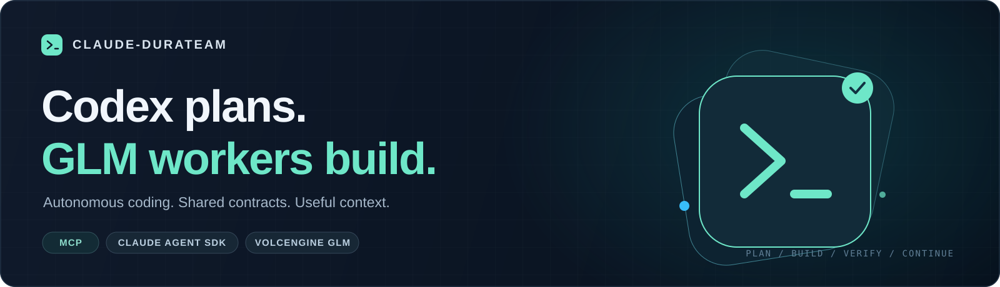
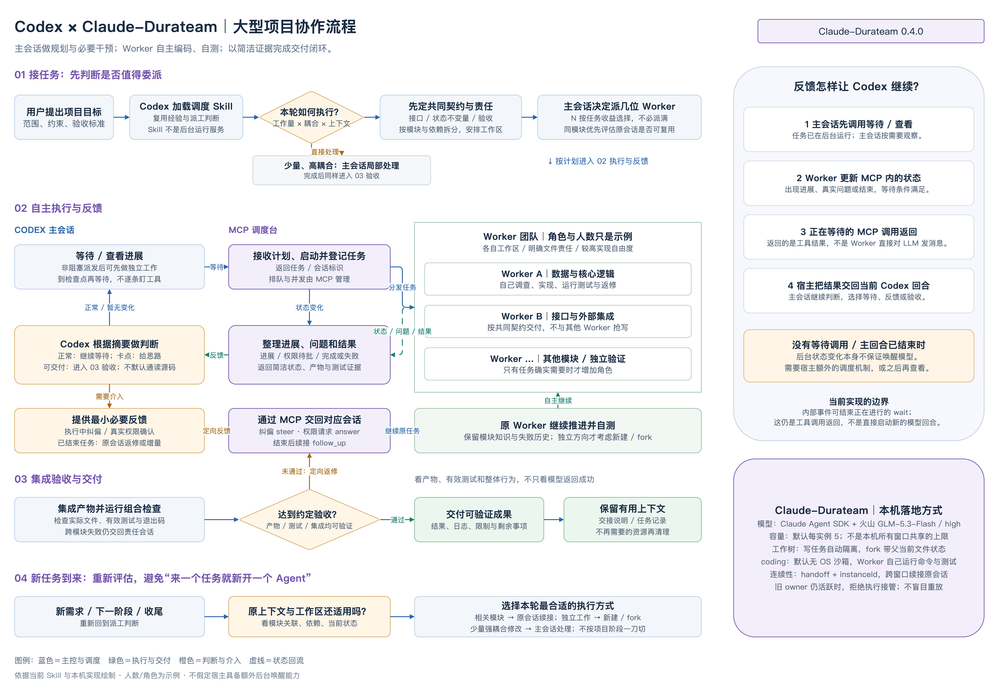

<div align="center">



# Claude-Durateam

**让 Codex 负责规划与协调，让 GLM Worker 自主编码、测试与返修。**

通过 MCP 连接 Codex 与 Claude Agent SDK，使用火山引擎 Coding Plan 运行多 Worker 工作流。

<p>
  <a href="package.json"></a>
  <a href="package.json"></a>
  <a href="PUBLICATION_AUDIT.md"></a>
  <a href="#workflow"></a>
</p>

<p>
  <a href="#quick-start">快速开始</a> ·
  <a href="#workflow">协作流程</a> ·
  <a href="#capabilities">核心能力</a> ·
  <a href="#skill">Codex Skill</a> ·
  <a href="#documentation">文档导航</a>
</p>

</div>

---

<a name="overview"></a>

## 一个主管，按任务组织一支编码团队

大型任务需要先确定接口契约、拆分模块，再让多个 Worker 分头实现。
Claude-Durateam 把这条协作路径接入 Codex：主会话决定派工与验收，Worker 在各自工作树中自主推进，遇到问题再定向反馈。

| 🛠️ 自主交付 | 🧩 并行协作 | 🔁 延续上下文 |
| :--- | :--- | :--- |
| Worker 自己调查、实现、运行测试和返修。 | 写任务使用独立 Git worktree，按模块约定责任范围。 | 相关增量优先续接原会话，独立方向可以 Fork。 |
| **默认 `coding` 模式** | **默认每实例 5 并发** | **`follow_up` · `fork` · `handoff`** |

> **派几个，由任务决定。** Skill 会评估工作量、依赖和已有上下文；少量且紧密耦合的改动可以由 Codex 局部处理，不要求每轮都启用多 Worker。

### 技术栈

<p>
  <a href="package.json"></a>
  <a href="package.json"></a>
  <a href="docs/REFERENCE.md"></a>
  <a href="src/state/sqlite.ts"></a>
  <a href="package.json"></a>
</p>

Worker 使用官方 `@anthropic-ai/claude-agent-sdk` 运行 Agent Loop，模型请求路由到火山引擎的 Anthropic 兼容端点。
支持 `glm-5.3` 与 `glm-5.3-flash`；主管 Skill 的常规编码选择为 **`glm-5.3-flash` / `high`**，派发时显式指定。

<a name="quick-start"></a>

## 🚀 快速开始

需要 **Node.js ≥ 22.19**、Git，以及可用的火山引擎 Coding Plan 凭据。目前实测环境为 macOS Apple Silicon / Node.js 26.13.0。

### 1. 获取并构建

```bash
git clone https://github.com/we1005/claude-durateam.git
cd claude-durateam
npm ci
npm run build
npm run doctor
```

当前从源码构建使用。`doctor` 只做本地诊断，不调用模型，也不显示密钥。

### 2. 准备私有凭据

把 API Key 保存到仓库外的私有文件中，文件只包含一行 token。
默认位置为 `~/.config/claude-durateam/credentials/volcengine.key`，也可以通过下一步的 `CLAUDE_DURATEAM_KEY_FILE` 指定其他绝对路径。建议目录权限为 `0700`、文件权限为 `0600`。

### 3. 接入 Codex

在 Codex 配置中添加以下条目，保留其他现有 MCP 配置。将示例路径替换为本机实际的绝对路径；完整示例见 [codex-config.example.toml](examples/codex-config.example.toml)。

```toml
[mcp_servers.claude_durateam]
command = "/absolute/path/to/node"
args = ["/absolute/path/to/claude-durateam/scripts/codex-mcp-launcher.mjs"]
startup_timeout_sec = 30
tool_timeout_sec = 120

[mcp_servers.claude_durateam.env]
CLAUDE_DURATEAM_KEY_FILE = "/absolute/private/volcengine.key"
CLAUDE_DURATEAM_ALLOWED_ROOTS = "/absolute/path/to/your-project"
CLAUDE_DURATEAM_MAX_CONCURRENT = "5"
```

重新连接 MCP 或新建 Codex 会话后，先调用 `init` 检查凭据状态、可用模型和容量，再开始派发任务。
写任务从干净的 Git 基线创建工作树；需要共享的契约和输入文件应先进入该基线。

<a name="skill"></a>

## 🧭 给 Codex 一套可复用的协作方法

仓库附带 [claude-durateam-orchestrator Skill](.agents/skills/claude-durateam-orchestrator/SKILL.md)，约定任务交接、并行判断、会话复用、反馈返修与验收方式。

其他项目也需要使用时，可从仓库根目录复制到个人 Skill 目录；已有同名版本时先比较内容：

```bash
mkdir -p ~/.agents/skills
cp -R .agents/skills/claude-durateam-orchestrator ~/.agents/skills/
```

在新会话中显式调用：

```text
用 $claude-durateam-orchestrator 完成这个项目。
使用 glm-5.3-flash / high，让 Worker 自主编码、测试和返修。
先确定共享契约，再按模块决定派几位 Worker；
相关增量优先复用已有会话，完成后集成并运行约定检查。
```

Skill 与 MCP 需要分别安装和配置。Skill 不在后台执行调度；自动发现也不代表每次请求都会隐式选中它。

<a name="workflow"></a>

## 🗺️ 从规划到交付

1. **规划与派工**：Codex 明确目标、接口、验收标准和文件责任，选择本轮执行方式与 Worker 数量。
2. **自主执行**：Worker 在各自工作树内实现、调试、自测，主管通过紧凑状态查看进展。
3. **定向反馈**：运行中可以纠偏；结束后的修复和增量交回原会话，保留已有模块知识。
4. **集成验收**：核对实际产物、有效测试与退出码，集成后再检查整体行为。
5. **延续工作**：通过会话续接或跨窗口交接推进新任务，按上下文价值决定是否另开 Worker。

<a href="architecture-drawio-pic/codex-claude-durateam-workflow.drawio.png">
  
</a>

<p align="center">
  <a href="architecture-drawio-pic/codex-claude-durateam-workflow.drawio.png">查看高清图</a> ·
  <a href="architecture-drawio-pic/codex-claude-durateam-workflow.drawio">下载可编辑 Draw.io</a> ·
  <a href="architecture-drawio-pic/codex-pi-durateam-workflow.drawio.png">Pi-Durateam 对照版本</a>
</p>

**反馈怎样回到 Codex？** Worker 更新状态后，等待中的 MCP 调用返回，宿主把工具结果交回当前 Codex 回合。
没有等待中的调用、或主回合已经结束时，后台状态变化本身不保证唤醒模型。

<a name="capabilities"></a>

## ⚙️ 核心能力

| 能力 | 当前行为 |
| :--- | :--- |
| **自主编码与测试** | 默认 `coding`：`acceptEdits` + 预批准 Bash，Worker 自行运行开发命令和返修；默认无 OS 沙箱。 |
| **按需并发** | 默认每实例 5 个并发 Worker，可配置为 1–32；不同连接实例不共享这份上限。 |
| **独立工作树** | 写任务自动创建 worktree；共享契约与文件责任由主管安排，产物需要显式集成。 |
| **精确续接与 Fork** | 使用精确会话 ID；写任务 Fork 带上父工作树的当前普通文件状态。 |
| **进展与控制** | 返回最近工具结果、写入收据、活动时间等摘要；支持等待、纠偏、取消与真实权限请求答复。 |
| **持久状态与交接** | SQLite 持久化状态，`handoff` 保存交接信息；跨窗口可续接已释放 ownership 的实例。 |
| **按任务选择资源** | 从操作者资源目录选择 Skill 与 MCP；不自动导入日常 Claude、Codex 或 Pi 配置。 |

### MCP 工具一览

| 用途 | 工具 |
| :--- | :--- |
| 发现与初始化 | `init` · `models` |
| 派发任务 | `spawn` · `spawn_batch` |
| 等待与观察 | `wait` · `status` · `sessions` |
| 继续与控制 | `follow_up` · `fork` · `steer` · `answer` · `abort` |
| 验收与交接 | 可选 `gate` · Codex launcher 的 `handoff` |

`spawn` 非阻塞；`wait` 有界，等待超时不等于任务失败。`steer` 的排队与送达分别记录；`answer` 对应真实权限请求。
参数、预算、Profile 和资源目录格式见 [配置与运行参考](docs/REFERENCE.md)。

<a name="verification"></a>

## 🧪 验证与边界

公开快照在 **2026-11-16** 完成验证：**31 个测试文件、206 项测试通过**，类型检查、构建与真实 stdio MCP 握手通过。
这项徽章表示该快照的验证记录，不是持续集成状态。复验命令：

```bash
npm run verify
```

常规验证不消耗模型额度。历史真实 GLM 调用、独立任务试用及失败记录分别保存在下方验证文档中；需要复跑模型验证时，使用 [参考文档中的显式 live 命令](docs/REFERENCE.md#测试)。

<details>
<summary><strong>使用前了解这些边界</strong></summary>

- 普通 `coding` 的 Bash 使用本机用户权限。工作树和隔离 HOME 用于组织任务，`allowedPaths` 限定文件工具写入与归属检查，不是宿主 Shell 的 OS 权限边界。需要沙箱时显式选择 `sandboxed-bash`。
- 默认不继承主力 Claude/Codex/Pi 设置。Skill 和 MCP 来自操作者批准的资源目录；密钥从私有文件读取。
- 跨窗口恢复要求原 owner 已退出；不能覆盖仍然活跃的任务，也不自动重放结果不明的执行。
- 跨工作树会话复用依赖当前锁定 SDK/CLI 的 transcript 布局。升级后需要重跑相关探针。
- Linux、其他 Node.js 版本和长期压力负载尚未实测。SDK 的费用估算不等于 Coding Plan 账单，整体省钱收益尚未完成对照验证。

</details>

<a name="documentation"></a>

## 📚 文档导航

| 从哪里开始 | 文档 |
| :--- | :--- |
| **配置与操作** | [完整配置、权限 Profile、工具契约和诊断](docs/REFERENCE.md) · [Codex 接入示例](examples/codex-config.example.toml) · [批次示例](examples/batch.example.json) |
| **主管 Skill** | [Skill 入口](.agents/skills/claude-durateam-orchestrator/SKILL.md) · [操作参考](.agents/skills/claude-durateam-orchestrator/references/claude-durateam-operations.md) |
| **流程与设计** | [Claude-Durateam 流程图](architecture-drawio-pic/codex-claude-durateam-workflow.drawio.png) · [Pi-Durateam 能力对照](PI_DURATEAM_COMPARISON.md) · [实施方案](CLAUDE_DURATEAM_IMPLEMENTATION_PLAN.md) |
| **验证记录** | [0.4 自主执行与交接验证](WORKFLOW_04_VALIDATION.md) · [独立 Skill 试用](SKILL_VALIDATION.md) · [Flash / high 早期证据](FLASH_HIGH_VALIDATION.json) |
| **公开审查** | [公开快照的敏感信息审查范围与结果](PUBLICATION_AUDIT.md) |

---

<div align="center">

**Codex · Claude Agent SDK · Volcengine GLM**

规划、实现、反馈、验收，在有用的上下文中持续推进。

</div>
